The second argument of [HGEvolve]() is the initial state. It can be a list of hyperedges, a [Graph](), a list of several states, or the name of a generated family: a grid, a surface (cylinder, torus, sphere, Klein bottle, Möbius strip), a sprinkling of Minkowski space, a point cloud around two Brill-Lindquist black holes, or a Poisson-disk or uniform point cloud. `"RandomSeed"` fixes what a family draws at random.

## An explicit initial state

Every example in this tutorial uses a rule that splits one edge into two:

```wl
rule = {{1, 2}} -> {{1, 3}, {3, 2}}
```

<!-- => {{1, 2}} -> {{1, 3}, {3, 2}} -->

An explicit initial state is a list of hyperedges. One step from a path of two edges reaches two states, one for each edge split:

```wl
HGEvolve[rule, {{1, 2}, {2, 3}}, 1, "StatesGraph", ImageSize -> 300, AspectRatio -> 1/2]
```

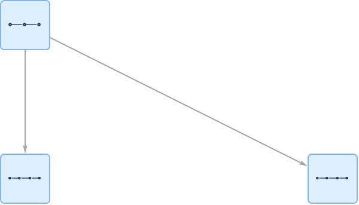

The engine numbers vertices from 0 in order of first appearance, and writes each edge as its id followed by its vertices:

```wl
First @ HGEvolve[rule, {{1, 2}, {2, 3}}, 0, "States"]
```

<!-- => <|"Id" -> 0, "CanonicalId" -> 0, "ContentStateId" -> 0, "Step" -> 0, "Edges" -> {{0, 0, 1}, {1, 1, 2}}, "IsInitial" -> 1|> -->

`"GlobalEdges"` lists the same edges:

```wl
HGEvolve[rule, {{1, 2}, {2, 3}}, 0, "GlobalEdges"]
```

<!-- => {{0, 0, 1}, {1, 1, 2}} -->

The generated families below are drawn from their `"GlobalEdges"` with this function:

```wl
initialStateGraph[globalEdges_List, opts___] := Graph[DirectedEdge @@@ Rest /@ globalEdges, opts, ImageSize -> {320, 220}]
```

```wl
initialStateGraph[HGEvolve[rule, {{1, 2}, {2, 3}}, 0, "GlobalEdges"], ImageSize -> 250]
```

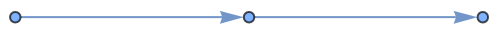

## A graph as the initial state

The edges of a [Graph]() become the hyperedges, in the order [EdgeList]() gives them:

```wl
List @@@ EdgeList[Graph[{1 <-> 2, 2 <-> 3}]]
```

<!-- => {{1, 2}, {2, 3}} -->

The graph and that list give the same evolution:

```wl
HGEvolve[rule, Graph[{1 <-> 2, 2 <-> 3}], 2, "NumStates"] === HGEvolve[rule, List @@@ EdgeList[Graph[{1 <-> 2, 2 <-> 3}]], 2, "NumStates"]
```

<!-- => True -->

## Several initial states

A list of states gives one initial state for each. The multiway system is the union of their evolutions:

```wl
HGEvolve[rule, {{{1, 2}}, {{1, 2}, {2, 3}}}, 1, "StatesGraph", ImageSize -> 420, AspectRatio -> 1/2]
```

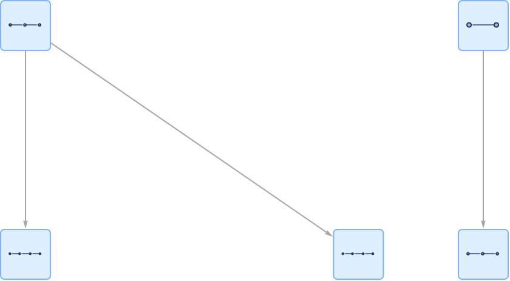

```wl
Dataset[HGEvolve[rule, {{{1, 2}}, {{1, 2}, {2, 3}}}, 0, "States"]]
```

Two copies of one state are two states by default, and one under `"CanonicalizeStates" -> Full`:

```wl
{HGEvolve[rule, {{{1, 2}}, {{1, 2}}}, 0, "NumStates"], HGEvolve[rule, {{{1, 2}}, {{1, 2}}}, 0, "NumStates", "CanonicalizeStates" -> Full]}
```

<!-- => {2, 1} -->

## Naming a family

A family can be named in two ways. As a string, shaped by options of [HGEvolve](): <code>[HGEvolve]()[*rule*, "Grid", *n*, *prop*, "GridWidth" -> 4]</code>. Or as an association whose `"Type"` is the family and whose other keys shape it: <code>[HGEvolve]()[*rule*, <|"Type" -> "Grid", "Width" -> 4|>, *n*, *prop*]</code>. A key in the association takes precedence over the option; a key left out takes the option's value.

The names are `"Grid"` (also `"GridWithHoles"`), `"Cylinder"`, `"Torus"`, `"Sphere"`, `"Klein"` (also `"KleinBottle"`), `"Mobius"` (also `"MobiusStrip"`), `"Sprinkling"` (also `"Minkowski"`), `"BrillLindquist"`, `"Poisson"` (also `"PoissonDisk"`) and `"Uniform"` (also `"UniformRandom"`). Any other name issues the message `HGEvolve::unknownic`.

The association's `"Width"` takes precedence over `"GridWidth"`, so this is a 4 by 4 grid:

```wl
Length[HGEvolve[rule, <|"Type" -> "Grid", "Width" -> 4, "Height" -> 4|>, 0, "GlobalEdges", "GridWidth" -> 8]]
```

<!-- => 24 -->

## Grids

`"Grid"` is a rectangular lattice of `"GridWidth"` by `"GridHeight"` vertices, 10 by 10 by default, with each edge in a random direction. The 24 edges of a 4 by 4 grid:

```wl
HGEvolve[rule, "Grid", 0, "GlobalEdges", "GridWidth" -> 4, "GridHeight" -> 4, "RandomSeed" -> 1]
```

<!-- => {{0, 0, 1}, {1, 0, 2}, {2, 3, 2}, {3, 4, 2}, {4, 4, 5}, {5, 4, 6}, {6, 6, 7}, {7, 8, 1}, {8, 1, 3}, {9, 9, 3}, {10, 3, 5}, {11, 10, 5}, {12, 5, 7}, {13, 11, 7}, {14, 12, 8}, {15, 8, 9}, {16, 9, 13}, {17, 9, 10}, {18, 10, 14}, {19, 11, 10}, {20, 15, 11}, {21, 13, 12}, {22, 14, 13}, {23, 15, 14}} -->

```wl
initialStateGraph[HGEvolve[rule, "Grid", 0, "GlobalEdges", "GridWidth" -> 4, "GridHeight" -> 4, "RandomSeed" -> 1], GraphLayout -> "SpringElectricalEmbedding"]
```

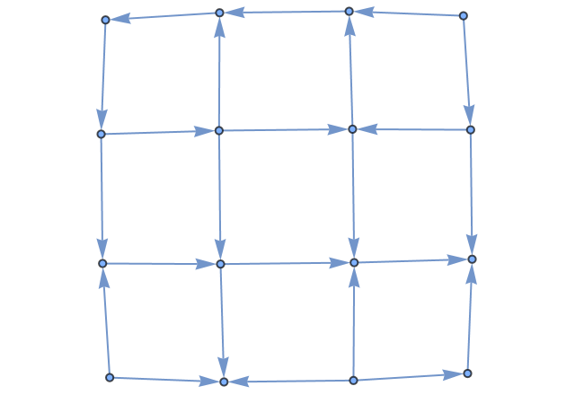

The default 10 by 10 grid has 180 edges:

```wl
Length[HGEvolve[rule, "Grid", 0, "GlobalEdges", "RandomSeed" -> 1]]
```

<!-- => 180 -->

Two steps from the 4 by 4 grid: the initial state, 24 states after one split, and 24 × 25 = 600 after two:

```wl
HGEvolve[rule, "Grid", 2, "NumStates", "GridWidth" -> 4, "GridHeight" -> 4, "RandomSeed" -> 1]
```

<!-- => 625 -->

---

`"GridHoles"` cuts circular holes, each `{x, y, radius}`, where the vertex in column *i* and row *j* is at (*i* - 1, *j* - 1). A vertex inside a hole is removed, and so is an edge whose midpoint is inside one. Two holes in a 6 by 6 grid:

```wl
initialStateGraph[HGEvolve[rule, "Grid", 0, "GlobalEdges", "GridWidth" -> 6, "GridHeight" -> 6, "GridHoles" -> {{1, 1, 0.8}, {4, 4, 0.8}}, "RandomSeed" -> 1], GraphLayout -> "SpringElectricalEmbedding"]
```

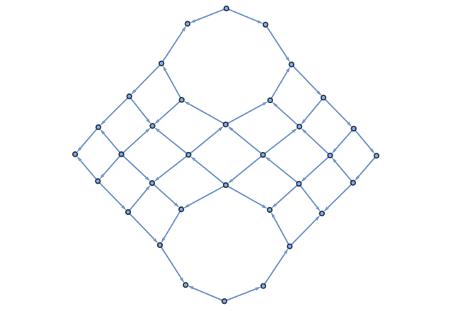

The holes remove 8 of the 60 edges:

```wl
{Length[HGEvolve[rule, "Grid", 0, "GlobalEdges", "GridWidth" -> 6, "GridHeight" -> 6, "RandomSeed" -> 1]], Length[HGEvolve[rule, "Grid", 0, "GlobalEdges", "GridWidth" -> 6, "GridHeight" -> 6, "GridHoles" -> {{1, 1, 0.8}, {4, 4, 0.8}}, "RandomSeed" -> 1]]}
```

<!-- => {60, 52} -->

The association keys are `"Width"`, `"Height"`, `"Holes"` and `"Seed"`. A 4 by 3 grid:

```wl
HGEvolve[rule, <|"Type" -> "Grid", "Width" -> 4, "Height" -> 3, "Seed" -> 1|>, 0, "GlobalEdges"]
```

<!-- => {{0, 0, 1}, {1, 0, 2}, {2, 3, 2}, {3, 4, 2}, {4, 4, 5}, {5, 1, 6}, {6, 1, 3}, {7, 7, 3}, {8, 3, 5}, {9, 8, 5}, {10, 6, 9}, {11, 7, 6}, {12, 7, 10}, {13, 8, 7}, {14, 11, 8}, {15, 9, 10}, {16, 10, 11}} -->

Two keys have no option. The key `"Diagonals"` with value `True` adds both diagonals of each cell, so the 4 by 3 grid has 12 more edges:

```wl
Length[HGEvolve[rule, <|"Type" -> "Grid", "Width" -> 4, "Height" -> 3, "Diagonals" -> True, "Seed" -> 1|>, 0, "GlobalEdges"]]
```

<!-- => 29 -->

The key `"RandomizeDirections"` with value `False` keeps every edge in the generator's own direction, so the seed has no effect on the grid:

```wl
SameQ @@ Table[HGEvolve[rule, <|"Type" -> "Grid", "Width" -> 4, "Height" -> 3, "RandomizeDirections" -> False, "Seed" -> s|>, 0, "GlobalEdges"], {s, 3}]
```

<!-- => True -->

`"RandomizeDirections"` applies to the surfaces and to the `"BrillLindquist"`, `"Poisson"` and `"Uniform"` clouds as well.

A lattice has at most 2^31 vertices. A larger grid, cylinder, torus, sphere, Klein bottle or Möbius strip is refused before it is generated:

```wl
HGEvolve[rule, <|"Type" -> "Grid", "Width" -> 50000, "Height" -> 50000|>, 0, "NumStates"]
```

<!-- => $Failed; the message HGEvolve::enginemsg is issued -->

## Surfaces

Five families join the sides of a grid:

- `"Torus"` joins both pairs of opposite sides of a square grid with `"Resolution"` vertices on a side.
- `"Cylinder"` joins two sides of a grid of `"Resolution"` columns and `"Height"` rows.
- `"Klein"` does the same as `"Cylinder"` with one side reversed.
- `"Mobius"` joins two sides of a grid of `"Resolution"` columns and `"Width"` rows, with one side reversed.
- `"Sphere"` has `"Resolution"` rings of latitude, with fewer vertices on the rings near the poles, and joins each vertex to the next on its ring and to the nearest vertex of the next ring.

With options, the resolution is `"GridWidth"` and the height is `"GridHeight"`; the Möbius width is 5 unless the association gives `"Width"`. Edge directions are drawn from `"RandomSeed"`. The association keys `"Radius"` (1 for the cylinder, sphere and Klein bottle, 2 for the Möbius strip) and `"MajorRadius"` and `"MinorRadius"` (3 and 1 for the torus) set the size of the surface in the coordinates of the `"InitialCondition"` property. They leave the edges unchanged.

A torus of resolution 4 has 32 edges:

```wl
Length[HGEvolve[rule, "Torus", 0, "GlobalEdges", "GridWidth" -> 4, "RandomSeed" -> 1]]
```

<!-- => 32 -->

```wl
initialStateGraph[HGEvolve[rule, "Torus", 0, "GlobalEdges", "GridWidth" -> 4, "RandomSeed" -> 1]]
```

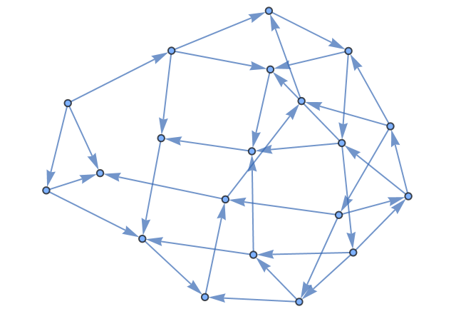

The same seed gives the same torus, and another seed reverses some of its edges:

```wl
{HGEvolve[rule, "Torus", 0, "GlobalEdges", "GridWidth" -> 4, "RandomSeed" -> 1] === HGEvolve[rule, "Torus", 0, "GlobalEdges", "GridWidth" -> 4, "RandomSeed" -> 1], HGEvolve[rule, "Torus", 0, "GlobalEdges", "GridWidth" -> 4, "RandomSeed" -> 1] === HGEvolve[rule, "Torus", 0, "GlobalEdges", "GridWidth" -> 4, "RandomSeed" -> 2]}
```

<!-- => {True, False} -->

---

A cylinder of 6 columns and 3 rows:

```wl
initialStateGraph[HGEvolve[rule, <|"Type" -> "Cylinder", "Resolution" -> 6, "Height" -> 3, "Seed" -> 1|>, 0, "GlobalEdges"]]
```

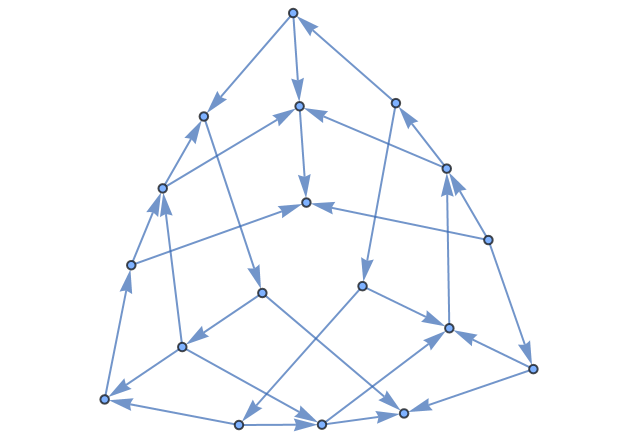

A sphere of resolution 4:

```wl
initialStateGraph[HGEvolve[rule, <|"Type" -> "Sphere", "Resolution" -> 4, "Seed" -> 1|>, 0, "GlobalEdges"]]
```


A Klein bottle of 5 columns and 3 rows:

```wl
initialStateGraph[HGEvolve[rule, <|"Type" -> "Klein", "Resolution" -> 5, "Height" -> 3, "Seed" -> 1|>, 0, "GlobalEdges"]]
```

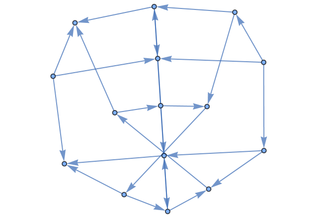

A Möbius strip of 6 columns and 3 rows:

```wl
initialStateGraph[HGEvolve[rule, <|"Type" -> "Mobius", "Resolution" -> 6, "Width" -> 3, "Seed" -> 1|>, 0, "GlobalEdges"], GraphLayout -> "SpringElectricalEmbedding"]
```


---

Two steps from the torus, with 32 edges and then 33 to split, reach 1 + 32 + 32 × 33 = 1089 states:

```wl
HGEvolve[rule, "Torus", 2, "NumStates", "GridWidth" -> 4, "RandomSeed" -> 1]
```

<!-- => 1089 -->

## Sprinklings of Minkowski space

`"Sprinkling"` (also `"Minkowski"`) places `"SprinklingDensity"` points (500 by default) at random in a region of flat spacetime of extent `"SprinklingTimeExtent"` (10) in time and `"SprinklingSpatialExtent"` (10) in each of `"SprinklingSpatialDim"` (2) space dimensions. `"SprinklingLightconeAngle"` (1) is the speed of light.

Two points are linked when one is in the other's future light cone within a proper time of `"SprinklingAlexandrovCutoff"` (5). `"SprinklingTransitivityReduction"` (`True`) removes each link implied by a chain of other links, and `"SprinklingMaxEdgesPerVertex"` (50) caps the links from each point. The hypergraph has an edge from each point to each point it is linked to; a point with no links is not in it.

A sprinkling of 24 points, with time running down the page:

```wl
initialStateGraph[HGEvolve[rule, "Sprinkling", 0, "GlobalEdges", "SprinklingDensity" -> 24, "RandomSeed" -> 1], GraphLayout -> "LayeredDigraphEmbedding", ImageSize -> 420]
```

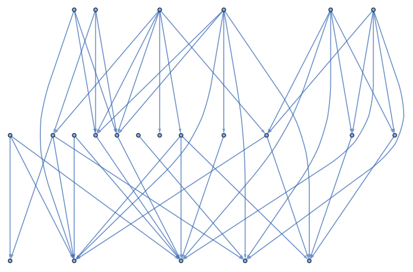

`"Sprinkling"` and `"Minkowski"` give the same result:

```wl
SameQ @@ Table[HGEvolve[rule, ic, 0, "GlobalEdges", "SprinklingDensity" -> 24, "RandomSeed" -> 1], {ic, {"Sprinkling", "Minkowski"}}]
```

<!-- => True -->

---

The number of edges with 1, 2 and 3 space dimensions:

```wl
Table[Length[HGEvolve[rule, "Sprinkling", 0, "GlobalEdges", "SprinklingDensity" -> 24, "SprinklingSpatialDim" -> d, "RandomSeed" -> 1]], {d, {1, 2, 3}}]
```

<!-- => {47, 47, 24} -->

With speeds of light 0.5, 1 and 2:

```wl
Table[Length[HGEvolve[rule, "Sprinkling", 0, "GlobalEdges", "SprinklingDensity" -> 24, "SprinklingLightconeAngle" -> c, "RandomSeed" -> 1]], {c, {0.5, 1., 2.}}]
```

<!-- => {19, 47, 62} -->

With Alexandrov cutoffs 1, 2, 5 and 10:

```wl
Table[Length[HGEvolve[rule, "Sprinkling", 0, "GlobalEdges", "SprinklingDensity" -> 24, "SprinklingAlexandrovCutoff" -> a, "RandomSeed" -> 1]], {a, {1., 2., 5., 10.}}]
```

<!-- => {1, 12, 47, 57} -->

With and without the transitivity reduction:

```wl
Table[Length[HGEvolve[rule, "Sprinkling", 0, "GlobalEdges", "SprinklingDensity" -> 24, "SprinklingTransitivityReduction" -> q, "RandomSeed" -> 1]], {q, {True, False}}]
```

<!-- => {47, 49} -->

At most one link from each point gives a forest:

```wl
initialStateGraph[HGEvolve[rule, "Sprinkling", 0, "GlobalEdges", "SprinklingDensity" -> 24, "SprinklingMaxEdgesPerVertex" -> 1, "RandomSeed" -> 1], GraphLayout -> "LayeredDigraphEmbedding"]
```

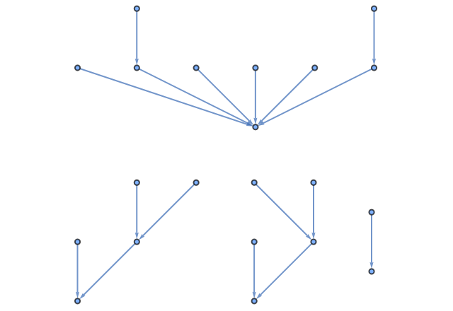

---

The association keys are the option names without `Sprinkling`: `"Density"`, `"TimeExtent"`, `"SpatialExtent"`, `"SpatialDim"`, `"LightconeAngle"`, `"AlexandrovCutoff"`, `"TransitivityReduction"`, `"MaxEdgesPerVertex"`, and `"Seed"`:

```wl
Length[HGEvolve[rule, <|"Type" -> "Sprinkling", "Density" -> 24, "SpatialDim" -> 1, "AlexandrovCutoff" -> 2., "Seed" -> 1|>, 0, "GlobalEdges"]]
```

<!-- => 32 -->

Two steps from the sprinkling of 24 points:

```wl
HGEvolve[rule, "Sprinkling", 2, "NumStates", "SprinklingDensity" -> 24, "RandomSeed" -> 1]
```

<!-- => 2304 -->

## Brill-Lindquist point clouds

`"BrillLindquist"` places `"SprinklingDensity"` points in the plane around two black holes of masses `"BrillLindquistMass1"` and `"BrillLindquistMass2"` (3 each), `"BrillLindquistSeparation"` (10) apart on the x axis, in the box `"BrillLindquistBoxX"` by `"BrillLindquistBoxY"` (-15 to 15 each). The density of points follows the volume element of the Brill-Lindquist metric ψ⁴ δ, which is ψ⁴ in the plane, with ψ = 1 + m1/(2 r1) + m2/(2 r2) and r1, r2 the distances to the two black holes, so points are denser near the horizons, and no point is inside a horizon, whose radius is half the mass. Two points closer than `"EdgeThreshold"` (2 when `Automatic`) are joined unless the midpoint between them is inside a horizon.

Thirty points in the default box have few pairs within that distance:

```wl
Length[HGEvolve[rule, "BrillLindquist", 0, "GlobalEdges", "SprinklingDensity" -> 30, "RandomSeed" -> 1]]
```

<!-- => 12 -->

A smaller box and a threshold of 4 join the points into one piece:

```wl
initialStateGraph[HGEvolve[rule, "BrillLindquist", 0, "GlobalEdges", "SprinklingDensity" -> 30, "BrillLindquistBoxX" -> {-8., 8.}, "BrillLindquistBoxY" -> {-8., 8.}, "EdgeThreshold" -> 4., "RandomSeed" -> 1]]
```

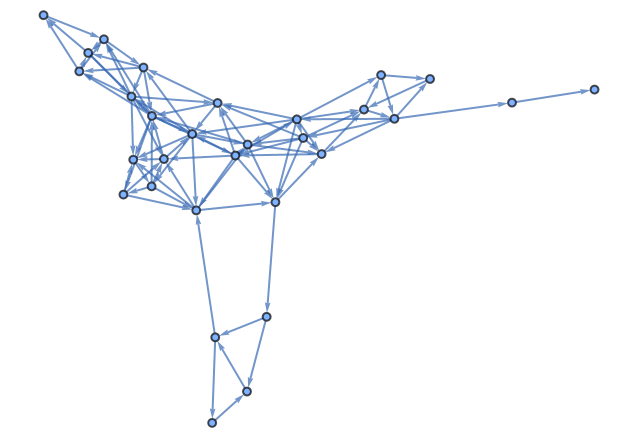

A point with no edge is not in the hypergraph. Here each of the 30 points has an edge:

```wl
VertexCount @ initialStateGraph @ HGEvolve[rule, "BrillLindquist", 0, "GlobalEdges", "SprinklingDensity" -> 30, "BrillLindquistBoxX" -> {-8., 8.}, "BrillLindquistBoxY" -> {-8., 8.}, "EdgeThreshold" -> 4., "RandomSeed" -> 1]
```

<!-- => 30 -->

---

The number of edges at thresholds 2, 3 and 4:

```wl
Table[Length[HGEvolve[rule, "BrillLindquist", 0, "GlobalEdges", "SprinklingDensity" -> 30, "BrillLindquistBoxX" -> {-8., 8.}, "BrillLindquistBoxY" -> {-8., 8.}, "EdgeThreshold" -> t, "RandomSeed" -> 1]], {t, {2., 3., 4.}}]
```

<!-- => {32, 54, 95} -->

The masses change where the points are placed, so the same seed gives different points at two masses:

```wl
SameQ @@ Table[HGEvolve[rule, "BrillLindquist", 0, "GlobalEdges", "SprinklingDensity" -> 30, "BrillLindquistMass1" -> m, "BrillLindquistMass2" -> m, "BrillLindquistBoxX" -> {-8., 8.}, "BrillLindquistBoxY" -> {-8., 8.}, "EdgeThreshold" -> 3., "RandomSeed" -> 1], {m, {1., 6.}}]
```

<!-- => False -->

The number of edges at separations 2, 6 and 20:

```wl
Table[Length[HGEvolve[rule, "BrillLindquist", 0, "GlobalEdges", "SprinklingDensity" -> 30, "BrillLindquistSeparation" -> s, "BrillLindquistBoxX" -> {-8., 8.}, "BrillLindquistBoxY" -> {-8., 8.}, "EdgeThreshold" -> 3., "RandomSeed" -> 1]], {s, {2., 6., 20.}}]
```

<!-- => {46, 66, 41} -->

---

The association keys are `"Density"`, `"Mass1"`, `"Mass2"`, `"Separation"`, `"BoxX"`, `"BoxY"`, `"BoxZ"`, `"Dimension"`, `"Periodic"`, `"EdgeThreshold"` and `"Seed"`:

```wl
Length[HGEvolve[rule, <|"Type" -> "BrillLindquist", "Density" -> 30, "Mass1" -> 3., "Mass2" -> 3., "Separation" -> 10., "BoxX" -> {-8., 8.}, "BoxY" -> {-8., 8.}, "EdgeThreshold" -> 3., "Seed" -> 1|>, 0, "GlobalEdges"]]
```

<!-- => 54 -->

Two steps, with isomorphic states identified:

```wl
HGEvolve[rule, "BrillLindquist", 2, "NumStates", "SprinklingDensity" -> 30, "BrillLindquistBoxX" -> {-8., 8.}, "BrillLindquistBoxY" -> {-8., 8.}, "EdgeThreshold" -> 3., "RandomSeed" -> 1, "CanonicalizeStates" -> Full]
```

<!-- => 1230 -->

### Three dimensions

With `"BrillLindquistDimension" -> 3` (key `"Dimension"`), the points fill a box whose z range is `"BrillLindquistBoxZ"` (key `"BoxZ"`, -15 to 15). The density of points is then ψ⁶, the volume element of ψ⁴ δ in three dimensions. With `"BrillLindquistPeriodic" -> True` (key `"Periodic"`), distances are measured to the nearest periodic image of a point, so two points near opposite faces of the box can be joined.

J. Gorard, arXiv:2102.09363, places two black holes of mass 0.5 at separation 1 in the centre of a periodic box of side 20. 200 points with a cut-off of 4.3, which is 1.25 times the mean spacing (8000/200)^(1/3) ≈ 3.42, form one connected piece:

```wl
gorard = <|"Type" -> "BrillLindquist", "Dimension" -> 3, "Periodic" -> True, "Density" -> 200, "Mass1" -> 0.5, "Mass2" -> 0.5, "Separation" -> 1., "BoxX" -> {-10., 10.}, "BoxY" -> {-10., 10.}, "BoxZ" -> {-10., 10.}, "EdgeThreshold" -> 4.3, "Seed" -> 1|>;
With[{g = Graph[DirectedEdge @@@ Rest /@ HGEvolve[rule, gorard, 0, "GlobalEdges"]]}, {VertexCount[g], EdgeCount[g], Length[WeaklyConnectedComponents[g]]}]
```

<!-- => {200, 788, 1} -->

The same points without periodic distances have fewer edges:

```wl
Length[HGEvolve[rule, Append[gorard, "Periodic" -> False], 0, "GlobalEdges"]]
```

<!-- => 638 -->

### The points

The `"InitialCondition"` property returns the generated initial condition with its points. `"VertexCoordinates"` gives each vertex's point, keyed by the vertex as the states name it, so the points can be drawn, measured or triangulated beside the evolution. The 200 points of the box above are three-dimensional, and none is inside a horizon:

```wl
ic = HGEvolve[rule, gorard, 0, "InitialCondition"];
pts = Values[ic["VertexCoordinates"]];
{Dimensions[pts], Min[Norm[# - {0.5, 0., 0.}] & /@ pts] > 0.25, Length[ic["Edges"]]}
```

<!-- => {{200, 3}, True, 788} -->

## Poisson-disk and uniform point clouds

`"Poisson"` places points at random in the box from 0 to 10 in each direction, and keeps a point only if it is at least `"PoissonMinDistance"` (1) from every point already kept. It makes up to 100 attempts for each of the `"SprinklingDensity"` points requested, so with a large minimum distance it keeps fewer. Two points closer than `"EdgeThreshold"` are joined; `Automatic` is twice the minimum distance.

Thirty points requested with a minimum distance of 2:

```wl
initialStateGraph[HGEvolve[rule, "Poisson", 0, "GlobalEdges", "SprinklingDensity" -> 30, "PoissonMinDistance" -> 2., "RandomSeed" -> 1]]
```

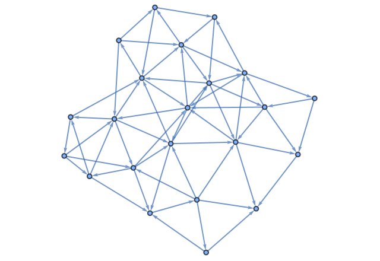

22 points are kept:

```wl
VertexCount @ initialStateGraph @ HGEvolve[rule, "Poisson", 0, "GlobalEdges", "SprinklingDensity" -> 30, "PoissonMinDistance" -> 2., "RandomSeed" -> 1]
```

<!-- => 22 -->

The number of edges at minimum distances 0.5, 1 and 2, each with its automatic threshold:

```wl
Table[Length[HGEvolve[rule, "Poisson", 0, "GlobalEdges", "SprinklingDensity" -> 30, "PoissonMinDistance" -> d, "RandomSeed" -> 1]], {d, {0.5, 1., 2.}}]
```

<!-- => {14, 40, 63} -->

And at thresholds 1.5, 2 and 3 with the default minimum distance:

```wl
Table[Length[HGEvolve[rule, "Poisson", 0, "GlobalEdges", "SprinklingDensity" -> 30, "EdgeThreshold" -> t, "RandomSeed" -> 1]], {t, {1.5, 2., 3.}}]
```

<!-- => {16, 40, 84} -->

The association keys are `"Density"`, `"MinDistance"`, `"BoxX"`, `"BoxY"`, `"EdgeThreshold"` and `"Seed"`. The box can only be set in the association. Boxes of side 10 and 20:

```wl
Table[Length[HGEvolve[rule, <|"Type" -> "Poisson", "Density" -> 30, "MinDistance" -> 2., "BoxX" -> {0, b}, "BoxY" -> {0, b}, "Seed" -> 1|>, 0, "GlobalEdges"]], {b, {10, 20}}]
```

<!-- => {63, 40} -->

---

`"Uniform"` places `"SprinklingDensity"` points at random in the same box, with no minimum distance. The automatic threshold is 1.5 times the square root of the box area divided by the number of points.

Twenty points:

```wl
initialStateGraph[HGEvolve[rule, "Uniform", 0, "GlobalEdges", "SprinklingDensity" -> 20, "RandomSeed" -> 1]]
```

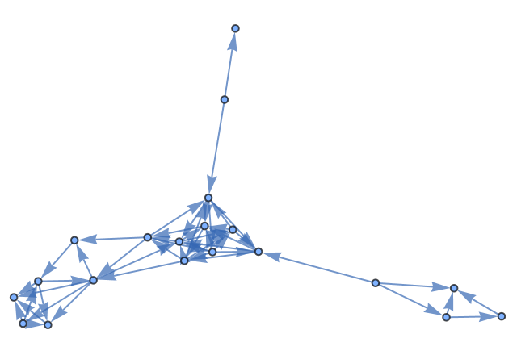

The number of edges at thresholds 2, 3 and 4:

```wl
Table[Length[HGEvolve[rule, "Uniform", 0, "GlobalEdges", "SprinklingDensity" -> 20, "EdgeThreshold" -> t, "RandomSeed" -> 1]], {t, {2., 3., 4.}}]
```

<!-- => {28, 44, 68} -->

The association keys are `"Density"`, `"BoxX"`, `"BoxY"`, `"EdgeThreshold"` and `"Seed"`. Twenty points in a box of side 5:

```wl
Length[HGEvolve[rule, <|"Type" -> "Uniform", "Density" -> 20, "BoxX" -> {0, 5}, "BoxY" -> {0, 5}, "EdgeThreshold" -> 2., "Seed" -> 1|>, 0, "GlobalEdges"]]
```

<!-- => 68 -->

Two steps from the twenty points, with isomorphic states identified:

```wl
HGEvolve[rule, "Uniform", 2, "NumStates", "SprinklingDensity" -> 20, "RandomSeed" -> 1, "CanonicalizeStates" -> Full]
```

<!-- => 1274 -->

## The random seed

`"RandomSeed"` is `Automatic` by default, which draws a new seed on each evaluation. Any other value fixes what a family draws: the points of a point cloud, and the edge directions of a grid or surface.

The same seed gives the same twenty uniform points each time:

```wl
SameQ @@ Table[HGEvolve[rule, "Uniform", 0, "GlobalEdges", "SprinklingDensity" -> 20, "RandomSeed" -> 1], {3}]
```

<!-- => True -->

Different seeds give different point clouds:

```wl
Table[Length[HGEvolve[rule, "Uniform", 0, "GlobalEdges", "SprinklingDensity" -> 20, "RandomSeed" -> s]], {s, {1, 2, 3}}]
```

<!-- => {50, 58, 60} -->

---

For a grid, the size fixes the number of edges and the seed fixes their directions. The directions change the number of states up to isomorphism:

```wl
Table[HGEvolve[rule, "Grid", 2, "NumStates", "GridWidth" -> 4, "GridHeight" -> 4, "RandomSeed" -> s, "CanonicalizeStates" -> Full], {s, {1, 2, 3}}]
```

<!-- => {276, 276, 300} -->

The `"Seed"` key of the association is the same seed:

```wl
Length[HGEvolve[rule, <|"Type" -> "Uniform", "Density" -> 20, "Seed" -> 2|>, 0, "GlobalEdges"]]
```

<!-- => 58 -->

`"RandomSeed"` also seeds the sampling options of the evolution, described in [Sampling and Pruning the Multiway System](paclet:WolframInstitute/HypergraphRewriteEngine/tutorial/SamplingAndPruning).
