`"StepStatistics"` gives one association per step of an evolution, with counts of states and classes, summaries of per-state invariants, distributions over vertices and, on request, measures of the branchial graph, the overlap between states and state x state matrices. The [HGEvolve]() reference page defines every key. This tutorial uses them to answer questions about rules of the Wolfram Physics Project and about the continuum limits studied by the Infrageometry program. Every number plotted comes from the engine.

Each plot reads one key of every step with this function:

```wl
perStep[stats_, keys__] := Table[{s["Step"], s[keys]}, {s, stats}]
```

## States and classes per step

How many of the states of the multiway system are distinct up to isomorphism? The rule is a rule of the Wolfram Physics Project, from two self-loops on one vertex:

```wl
wolfram = {{x, y}, {x, z}} -> {{x, y}, {x, w}, {y, w}, {z, w}};
classes = HGEvolve[wolfram, {{0, 0}, {0, 0}}, 5, "StepStatistics", "CanonicalizeStates" -> Full, "ExploreFromCanonicalStatesOnly" -> True];
Lookup[classes, {"Step", "RawStates", "Classes"}]
```

<!-- => {{0, 1, 1}, {1, 2, 1}, {2, 24, 3}, {3, 408, 18}, {4, 9504, 156}, {5, 280080, 1776}} -->

With `"ExploreFromCanonicalStatesOnly" -> True`, the engine expands one state per class and counts the states of each class, so `"RawStates"` is the number of states of the full multiway system. The number of classes grows more slowly:

```wl
ListLogPlot[{perStep[classes, "RawStates"], perStep[classes, "Classes"]}, Joined -> True, PlotMarkers -> Automatic, AxesLabel -> {"step", "count"}, PlotLegends -> {"states", "classes"}, ImageSize -> 400]
```

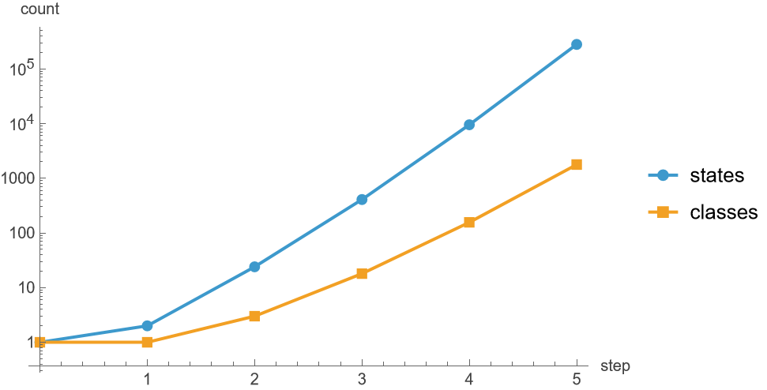

`"MultiplicityHistogram"` maps a class size to the number of classes of that size. The class sizes at steps 4 and 5:

```wl
ListLogLogPlot[Table[Normal[classes[[s + 1]]["MultiplicityHistogram"]] /. Rule -> List, {s, {4, 5}}], PlotMarkers -> Automatic, AxesLabel -> {"states in the class", "classes"}, PlotLegends -> {"step 4", "step 5"}, ImageSize -> 400]
```

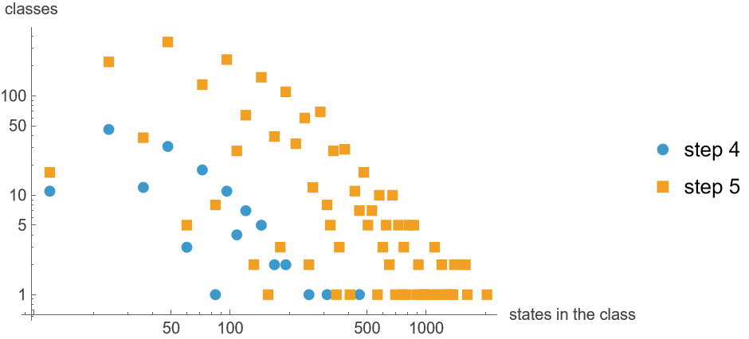

## Dimension of a growth history

Does a growth rule settle at a fixed dimension? `"UniformRandom" -> True` with `"MatchesPerStep" -> 20` keeps 20 transitions, and so 20 states, at each step:

```wl
growth = {{x, y}, {x, z}} -> {{x, z}, {x, w}, {y, w}, {z, w}};
history = HGEvolve[growth, {{1, 2}, {2, 3}, {3, 4}, {2, 4}}, 200, "StepStatistics", "UniformRandom" -> True, "MatchesPerStep" -> 20, "RandomSeed" -> 1];
```

The mean over the step's states of the Wolfram-Hausdorff dimension, and of the largest local dimension of a vertex in each state:

```wl
ListLinePlot[{perStep[history, "Invariants", "WolframHausdorffDimension", "Mean"], perStep[history, "Invariants", "LocalDimensionMax", "Mean"]}, AxesLabel -> {"step", "dimension"}, PlotLegends -> {"mean over vertices", "largest vertex"}, ImageSize -> 400]
```

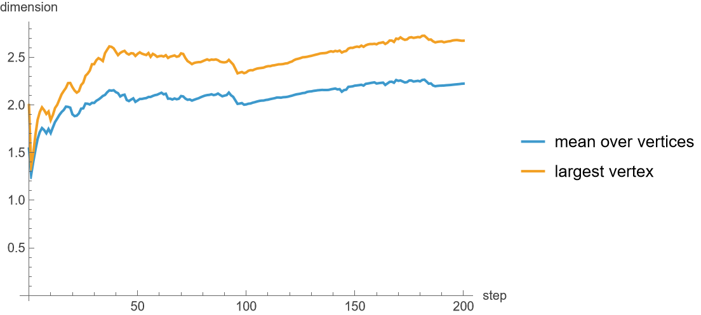

The vertex count grows by one per step:

```wl
ListLinePlot[perStep[history, "Invariants", "VertexCount", "Mean"], AxesLabel -> {"step", "vertices"}, ImageSize -> 400]
```

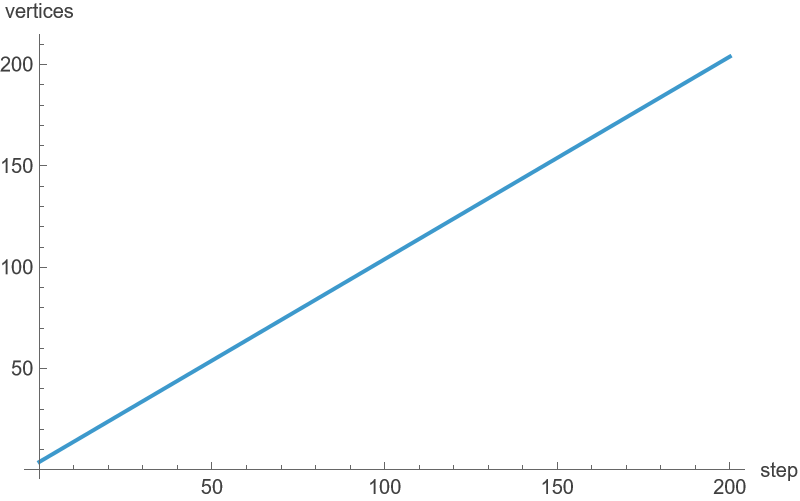

The 20 states of a step are 20 branches. The `"Histogram"` of `"LargestComponentDimension"` in `"Invariants"` maps each dimension, rounded to 0.01, to the number of states with that dimension. The dimension over the branches at steps 50, 100 and 200:

```wl
Histogram[Table[With[{h = history[[s + 1]]["Invariants", "LargestComponentDimension", "Histogram"]}, WeightedData[Keys[h], Values[h]]], {s, {50, 100, 200}}], {0.01}, "Probability", AxesLabel -> {"dimension", "fraction of states"}, ChartLegends -> {"step 50", "step 100", "step 200"}, ImageSize -> 400]
```

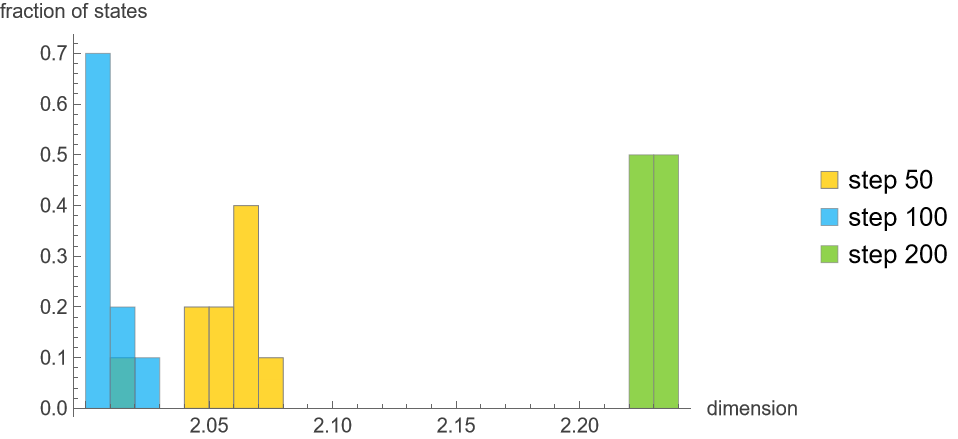

`"BallGrowthDimension"` maps each radius r to the summary over the states of the dimension measured from the growth of balls between radius r - 1 and r. The mean at steps 50, 100 and 200:

```wl
ListLinePlot[Table[KeyValueMap[{#1, #2["Mean"]} &, history[[s + 1]]["BallGrowthDimension"]], {s, {50, 100, 200}}], PlotMarkers -> Automatic, AxesLabel -> {"radius", "dimension"}, PlotLegends -> {"step 50", "step 100", "step 200"}, ImageSize -> 400]
```

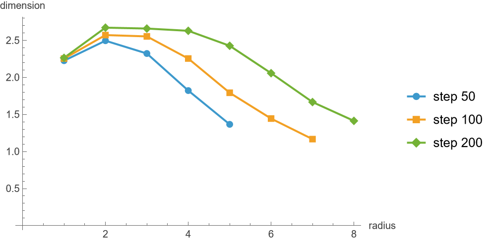

## Free space and a gravitational field

Does the same rule give a different dimension and curvature in free space and near two black holes? The rule replaces a path of four edges with four edges through a new vertex. One run starts from a torus of 81 vertices, the other from a Brill-Lindquist point cloud of 80 points around two black holes, both described in [Generated Initial Conditions](paclet:WolframInstitute/HypergraphRewriteEngine/tutorial/InitialConditions):

```wl
ruleA = {{x, y}, {y, z}, {z, w}, {w, v}} -> {{y, u}, {u, v}, {w, x}, {x, u}};
torus = HGEvolve[ruleA, <|"Type" -> "Torus", "Resolution" -> 9, "Seed" -> 1|>, 40, "StepStatistics", "UniformRandom" -> True, "MatchesPerStep" -> 10, "RandomSeed" -> 1];
blackHoles = HGEvolve[ruleA, <|"Type" -> "BrillLindquist", "Density" -> 80, "Separation" -> 6., "BoxX" -> {-10., 10.}, "BoxY" -> {-10., 10.}, "EdgeThreshold" -> 3.5, "Seed" -> 1|>, 40, "StepStatistics", "UniformRandom" -> True, "MatchesPerStep" -> 10, "RandomSeed" -> 1];
```

The Brill-Lindquist state has two components, and `"WolframHausdorffDimension"` is undefined for a disconnected state:

```wl
{First[torus]["Invariants", "Components", "Mean"], First[blackHoles]["Invariants", "Components", "Mean"]}
```

<!-- => {1., 2.} -->

`"LargestComponentDimension"` is the dimension of the largest component, so it is defined for both:

```wl
ListLinePlot[{perStep[torus, "Invariants", "LargestComponentDimension", "Mean"], perStep[blackHoles, "Invariants", "LargestComponentDimension", "Mean"]}, AxesLabel -> {"step", "dimension"}, PlotLegends -> {"torus", "Brill-Lindquist"}, ImageSize -> 400]
```

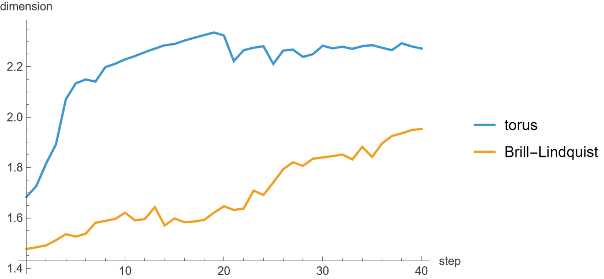

The mean Ollivier-Ricci curvature of the edges:

```wl
ListLinePlot[{perStep[torus, "Invariants", "OllivierRicciCurvature", "Mean"], perStep[blackHoles, "Invariants", "OllivierRicciCurvature", "Mean"]}, AxesLabel -> {"step", "curvature"}, PlotLegends -> {"torus", "Brill-Lindquist"}, ImageSize -> 400]
```

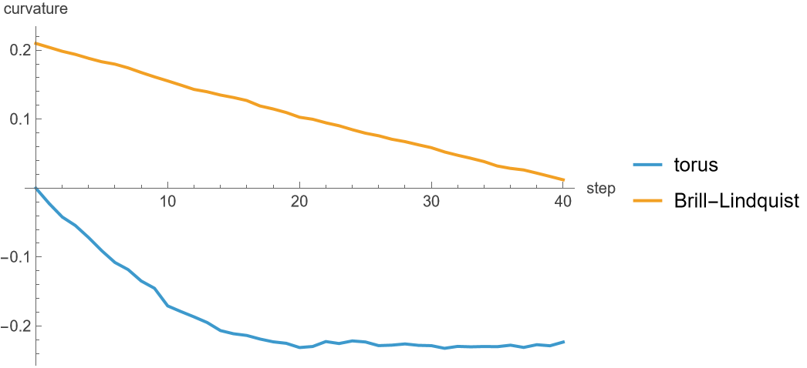

## The distribution of curvature

How is curvature spread over the vertices of all branches at a step? `"VertexInvariants"` pools the vertices of every state at the step. Its `"Histogram"` maps the lower edge of each bin to the number of vertices in the bin. Curvature has 32 bins of width 3/32 from -2 to 1. The curvature of the vertices at steps 5, 20 and 40, as a fraction of the vertices:

```wl
vertexHistogram[stats_, step_, key_] := With[{h = stats[[step + 1]]["VertexInvariants", key, "Histogram"]}, WeightedData[Keys[h], Values[h]]];
Row[Table[Histogram[{vertexHistogram[torus, s, "OllivierRicciCurvature"], vertexHistogram[blackHoles, s, "OllivierRicciCurvature"]}, {-2, 1, 3/32}, "Probability", PlotRange -> {{-1, 1}, {0, 0.6}}, AxesLabel -> {"curvature", "fraction"}, PlotLabel -> "step " <> ToString[s], ChartLegends -> If[s == 40, {"torus", "Brill-Lindquist"}, None], ImageSize -> 260], {s, {5, 20, 40}}], Spacer[30]]
```

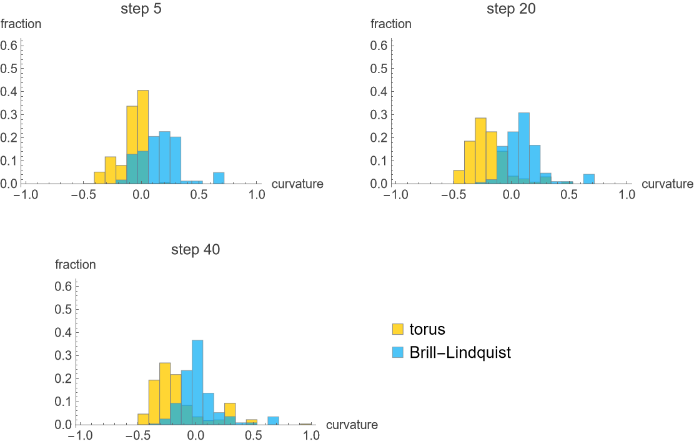

Each column of this plot is the curvature histogram of one step, shaded by the fraction of the vertices in each bin:

```wl
curvatureColumn[s_] := With[{h = s["VertexInvariants", "OllivierRicciCurvature", "Histogram"]}, Lookup[KeyMap[Round[32 (# + 2)/3] &, h/Total[h]], Range[10, 31], 0]];
Row[Table[ArrayPlot[Reverse[Transpose[curvatureColumn /@ run[[1]]]], DataRange -> {{0, 40}, {-1.0625, 1}}, FrameTicks -> {{Range[-1, 1, 1/2], None}, {Range[0, 40, 10], None}}, FrameLabel -> {"curvature", "step"}, PlotLabel -> run[[2]], ColorFunction -> "SunsetColors", PlotLegends -> Automatic, AspectRatio -> 1, ImageSize -> 300], {run, {{torus, "torus"}, {blackHoles, "Brill-Lindquist"}}}], Spacer[30]]
```

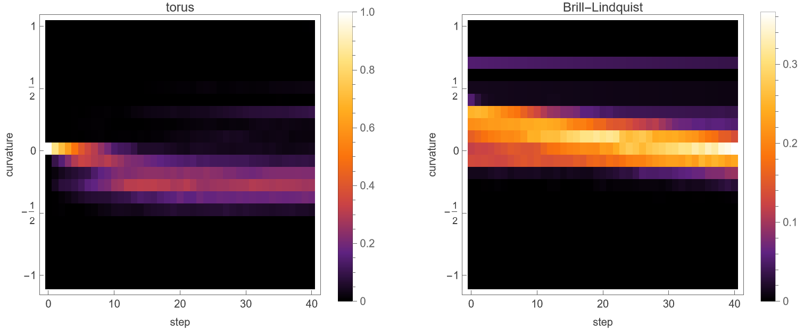

The local dimension of the vertices has 32 bins of width 1/4 from 0 to 8. At steps 5, 20 and 40:

```wl
Row[Table[Histogram[{vertexHistogram[torus, s, "LocalDimension"], vertexHistogram[blackHoles, s, "LocalDimension"]}, {0, 8, 1/4}, "Probability", PlotRange -> {{0, 4}, {0, 0.8}}, AxesLabel -> {"dimension", "fraction"}, PlotLabel -> "step " <> ToString[s], ChartLegends -> If[s == 40, {"torus", "Brill-Lindquist"}, None], ImageSize -> 260], {s, {5, 20, 40}}], Spacer[30]]
```

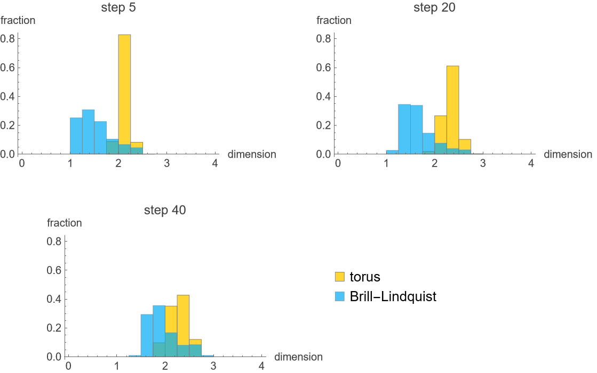

`"DegreeHistogram"` maps a degree to the number of vertices with that degree. At step 40:

```wl
Histogram[Table[With[{h = run[[41]]["DegreeHistogram"]}, WeightedData[Keys[h], Values[h]]], {run, {torus, blackHoles}}], {1/2, 30, 1}, "Probability", AxesLabel -> {"degree", "fraction"}, ChartLegends -> {"torus", "Brill-Lindquist"}, ImageSize -> 400]
```

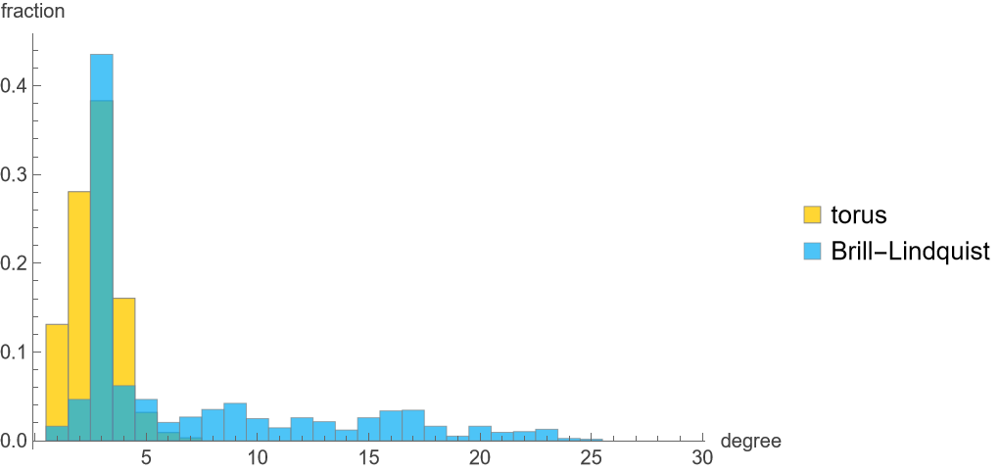

The quantiles of the vertex curvature of the Brill-Lindquist run:

```wl
ListLinePlot[Table[perStep[blackHoles, "VertexInvariants", "OllivierRicciCurvature", q], {q, {"P10", "Q1", "Median", "Q3", "P90"}}], AxesLabel -> {"step", "curvature"}, PlotLegends -> {"10th percentile", "first quartile", "median", "third quartile", "90th percentile"}, ImageSize -> 400]
```

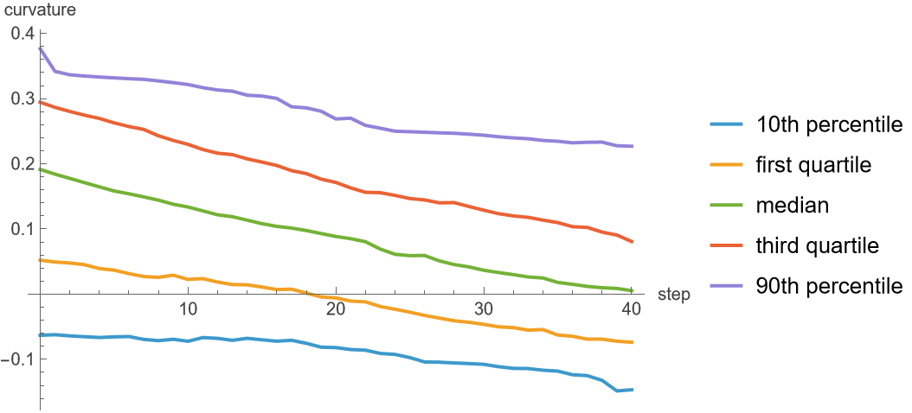

The skewness of the same distribution in both runs:

```wl
ListLinePlot[{perStep[torus, "VertexInvariants", "OllivierRicciCurvature", "Skewness"], perStep[blackHoles, "VertexInvariants", "OllivierRicciCurvature", "Skewness"]}, AxesLabel -> {"step", "skewness"}, PlotRange -> All, PlotLegends -> {"torus", "Brill-Lindquist"}, ImageSize -> 400]
```

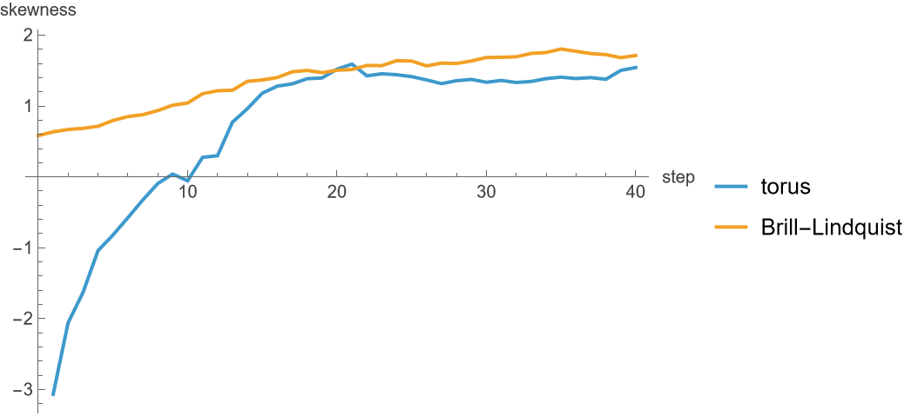

## Is curvature local?

Do vertices of high curvature sit next to each other, or does curvature follow the degree? `"OllivierMoranI"` is Moran's I of the vertex curvature over the edges of a state, positive when neighbours have similar curvature. It is undefined when every vertex has the same curvature, as on the torus at step 0:

```wl
ListLinePlot[{perStep[torus, "Invariants", "OllivierMoranI", "Mean"], perStep[blackHoles, "Invariants", "OllivierMoranI", "Mean"]}, AxesLabel -> {"step", "Moran's I"}, PlotLegends -> {"torus", "Brill-Lindquist"}, ImageSize -> 400]
```

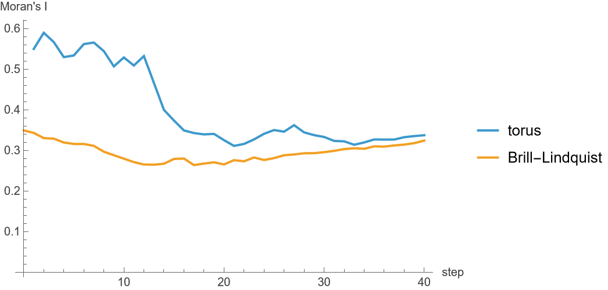

`"OllivierDegreeCorrelation"` is the correlation of the vertex curvature with the vertex degree:

```wl
ListLinePlot[{perStep[torus, "Invariants", "OllivierDegreeCorrelation", "Mean"], perStep[blackHoles, "Invariants", "OllivierDegreeCorrelation", "Mean"]}, AxesLabel -> {"step", "correlation"}, PlotLegends -> {"torus", "Brill-Lindquist"}, ImageSize -> 400]
```

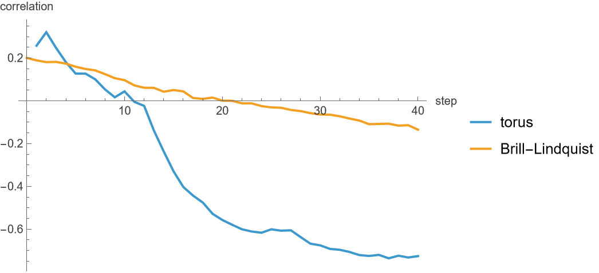

## Branches and the initial state

How similar are the states at a step, and how much of the initial state do they keep? `"StepStatisticsBranchial" -> All` adds the branchial graph measures and the overlap of the states' vertex sets. `"MaxStatesPerStep" -> 400` keeps 400 states at each step:

```wl
branches = HGEvolve[ruleA, <|"Type" -> "Grid", "Width" -> 8, "Height" -> 8, "Seed" -> 1|>, 10, "StepStatistics", "MaxStatesPerStep" -> 400, "StepStatisticsBranchial" -> All];
```

The mean over every two states of their cosine similarity and their mutual information, and the mean over the states of their mutual information with the initial state, in bits. At step 0 the only state is the initial state, so every vertex is in both sets and the mutual information is 0:

```wl
ListLinePlot[{perStep[branches, "StateCosineSimilarity", "Mean"], perStep[branches, "StateMutualInformation", "Mean"], perStep[branches, "InitialStateMutualInformation", "Mean"]}, AxesLabel -> {"step", None}, PlotLegends -> {"cosine similarity", "mutual information", "mutual information with the initial state"}, ImageSize -> 400]
```

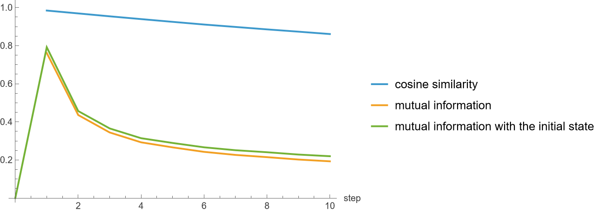

The mean branch entropy of a vertex and of an edge, log2 k for an item held by k states:

```wl
ListLinePlot[{perStep[branches, "BranchEntropy", "Mean"], perStep[branches, "EdgeBranchEntropy", "Mean"]}, AxesLabel -> {"step", "bits"}, PlotLegends -> {"vertex", "edge"}, ImageSize -> 400]
```

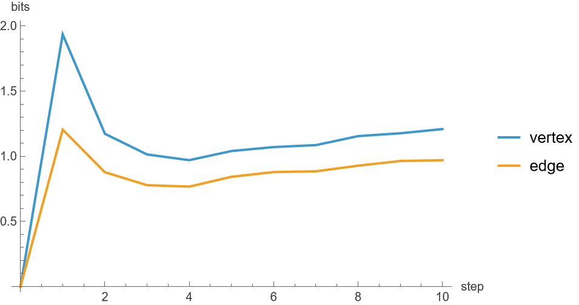

`"OverlapByBranchialDistance"` gives, for each branchial distance d, the summary of the Jaccard index of the vertex sets of the pairs of states at distance d. At steps 1 and 2:

```wl
ListLinePlot[Table[KeyValueMap[{#1, #2["Mean"]} &, branches[[s + 1]]["OverlapByBranchialDistance"]], {s, {1, 2}}], PlotMarkers -> Automatic, AxesLabel -> {"branchial distance", "Jaccard index"}, PlotLegends -> {"step 1", "step 2"}, ImageSize -> 400]
```

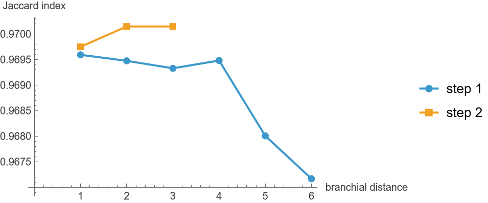

## Mutual information between states

How much does each state at a step tell about each other state? `"StepStatisticsMatrices"` adds `"StateMatrices"` to each step: the step's state ids and a state x state matrix for each measure asked for. The rule adds a square on every path of two edges, from two self-loops. `"MatchesPerStep" -> 10` keeps 10 states at each step:

```wl
square = {{a, b}, {b, c}} -> {{a, b}, {b, c}, {c, d}, {d, a}};
pairs = HGEvolve[square, {{0, 0}, {0, 0}}, 10, "StepStatistics", "UniformRandom" -> True, "MatchesPerStep" -> 10, "RandomSeed" -> 1, "StepStatisticsMatrices" -> All];
Keys[Last[pairs]["StateMatrices"]]
```

<!-- => {"States", "StateOverlap", "StateCosineSimilarity", "StateMutualInformation", "StateEdgeOverlap", "StateEdgeCosineSimilarity", "StateEdgeMutualInformation"} -->

The mutual information in bits between every two states, as vertex sets, at steps 1 to 10. Row and column i are the i-th id of `"States"`, row 1 at the top, and the diagonal is the entropy of each state:

```wl
Grid[Partition[Table[ArrayPlot[pairs[[s + 1]]["StateMatrices", "StateMutualInformation"], ColorFunction -> "TemperatureMap", Frame -> True, PlotLabel -> "step " <> ToString[s], ImageSize -> 140], {s, 1, 10}], 5]]
```

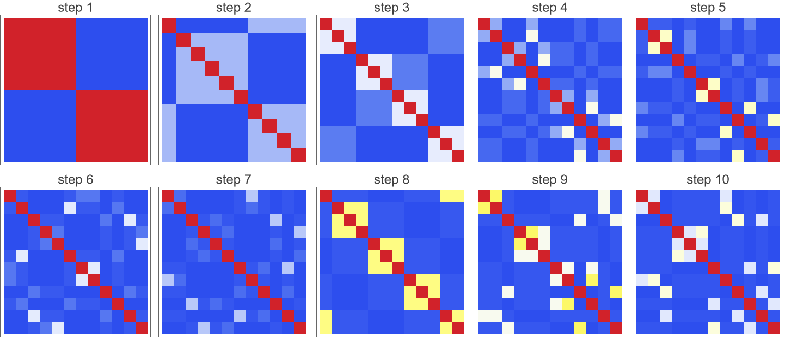

The same at step 10 over vertex sets and over edge sets, and the cosine similarity of the vertex sets:

```wl
With[{m = Last[pairs]["StateMatrices"]}, Grid[{MapThread[ArrayPlot[m[#1], ColorFunction -> "TemperatureMap", Frame -> True, PlotLabel -> #2, PlotLegends -> Automatic, ImageSize -> 200] &, {{"StateMutualInformation", "StateEdgeMutualInformation", "StateCosineSimilarity"}, {"vertex mutual information", "edge mutual information", "cosine similarity"}}]}, Spacings -> 2]]
```

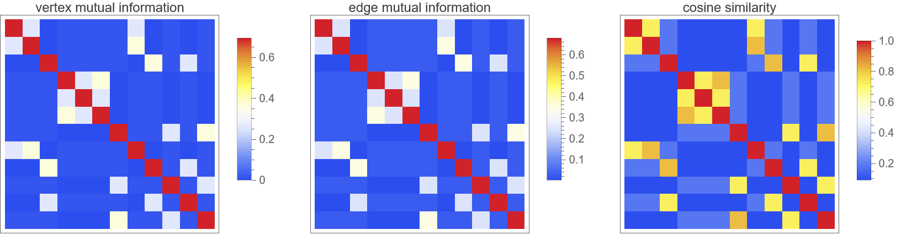

## Curvature on a spectral embedding

Where on a state does the curvature sit, and how does it move as the state grows? `"IncludeVertexCurvature" -> True` adds `"VertexCurvature"` to each state record: each vertex with a neighbour and its Ollivier-Ricci curvature. `"MatchesPerStep" -> 1` follows one history of rule A from the grid:

```wl
history = HGEvolve[ruleA, <|"Type" -> "Grid", "Width" -> 8, "Height" -> 8, "Seed" -> 1|>, 30, "States", "UniformRandom" -> True, "MatchesPerStep" -> 1, "RandomSeed" -> 1, "IncludeVertexCurvature" -> True];
Length[history]
```

<!-- => 31 -->

The graph of a state joins the consecutive vertices of each hyperedge; `Rest` drops the edge id at the front of each edge. `GraphEmbedding` with `"SpectralEmbedding"` places each vertex at the coordinates of three eigenvectors of the graph Laplacian, and each point is coloured by the vertex's curvature from blue (the state's lowest) to red (its highest):

```wl
stateGraph[state_] := Graph[UndirectedEdge @@@ DeleteDuplicates[Sort /@ Select[Catenate[Partition[#, 2, 1] & /@ (Rest /@ state["Edges"])], #[[1]] =!= #[[2]] &]]];
embedding[state_] := With[{g = stateGraph[state]}, Graphics3D[{PointSize[0.025], Point[GraphEmbedding[g, "SpectralEmbedding", 3], VertexColors -> (ColorData["TemperatureMap"][Rescale[#, MinMax[Values[state["VertexCurvature"]]]]] & /@ Lookup[state["VertexCurvature"], VertexList[g], 0])]}, Boxed -> True, PlotLabel -> "step " <> ToString[state["Step"]], ImageSize -> 220]];
Row[embedding[SelectFirst[Values[history], Function[st, st["Step"] == #]]] & /@ {0, 15, 30}, Spacer[10]]
```

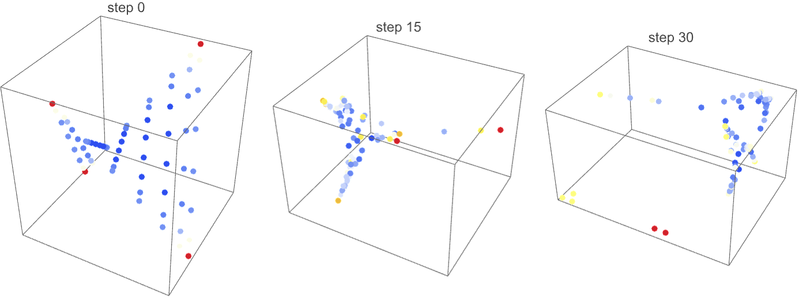

In a notebook, `ListAnimate[embedding /@ SortBy[Values[history], #Step &]]` shows every step as an animation.

## Two readings of dimension

The Infrageometry program reads the dimension of a graph from the growth of its balls. The counting measure counts every vertex of a ball. The Riemannian measure counts only the vertices whose neighbours all lie in the ball. On square grids of width 8 to 32 the counting reading rises from 1.29 to 1.63, and the Riemannian reading falls from 2.15 to 1.89, crossing 2 between widths 16 and 24. `"StepStatisticsMeasures" -> All` adds both readings and the other measures of this tutorial's remaining sections. The helper `zeroStep` gives the statistics of a generated state without any evolution:

```wl
zeroStep[spec_] := First[HGEvolve[ruleA, spec, 0, "StepStatistics", "StepStatisticsMeasures" -> All]];
grids = Table[{n, zeroStep[<|"Type" -> "Grid", "Width" -> n, "Height" -> n, "Seed" -> 1|>]}, {n, {8, 12, 16, 24, 32}}];
ListLinePlot[{Table[{p[[1]], p[[2]]["Invariants", "BallDimension", "Mean"]}, {p, grids}], Table[{p[[1]], p[[2]]["Invariants", "RiemannianBallDimension", "Mean"]}, {p, grids}]}, PlotMarkers -> Automatic, AxesLabel -> {"grid width", "dimension"}, PlotLegends -> {"counting measure", "Riemannian measure"}, GridLines -> {None, {2}}, ImageSize -> 400]
```

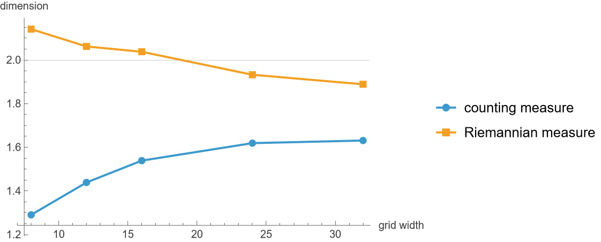

## Curvature of a flat surface under refinement

A torus is flat. Its scalar curvature from ball growth stays between -0.04 and -0.10 for resolutions 6 to 18 and does not approach 0 over this range:

```wl
ListLinePlot[Table[{k, zeroStep[<|"Type" -> "Torus", "Resolution" -> k, "Seed" -> 1|>]["Invariants", "BallScalarCurvature", "Mean"]}, {k, {6, 9, 12, 15, 18}}], PlotMarkers -> Automatic, AxesLabel -> {"resolution", "scalar curvature"}, GridLines -> {None, {0}}, ImageSize -> 400]
```

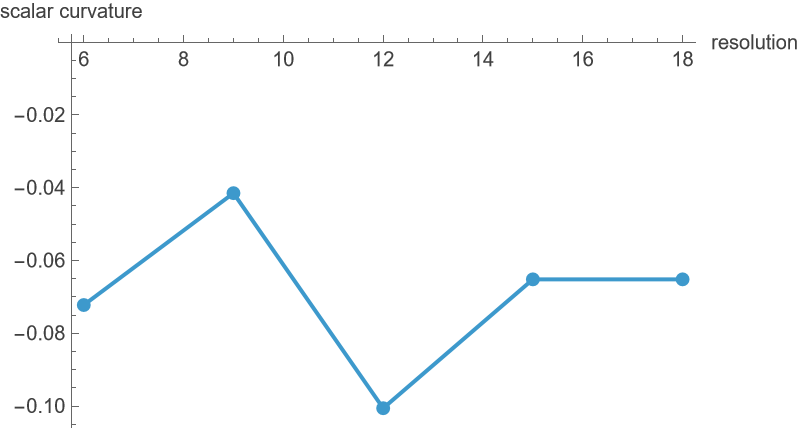

## Curvature readings near two black holes

The evolutions of the section on free space and a gravitational field, run again with every measure, compare three readings of curvature: ball growth, sphere growth, and the transport curvature of edges with no idleness:

```wl
measured[spec_] := HGEvolve[ruleA, spec, 40, "StepStatistics", "UniformRandom" -> True, "MatchesPerStep" -> 10, "RandomSeed" -> 1, "StepStatisticsMeasures" -> All];
grTorus = measured[<|"Type" -> "Torus", "Resolution" -> 9, "Seed" -> 1|>];
grHoles = measured[<|"Type" -> "BrillLindquist", "Density" -> 80, "Separation" -> 6., "BoxX" -> {-10., 10.}, "BoxY" -> {-10., 10.}, "EdgeThreshold" -> 3.5, "Seed" -> 1|>];
GraphicsRow[Table[ListLinePlot[{perStep[grTorus, "Invariants", key, "Mean"], perStep[grHoles, "Invariants", key, "Mean"]}, AxesLabel -> {"step", None}, PlotLabel -> key, PlotLegends -> {"torus", "Brill-Lindquist"}], {key, {"BallScalarCurvature", "SphereScalarCurvature", "NonLazyOllivierRicciCurvature"}}], ImageSize -> 800]
```

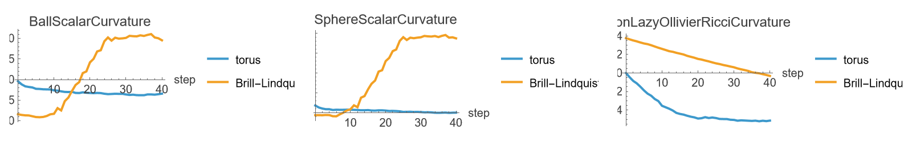

The spread of the edge curvature over all edges of all states at a step falls if evolution smooths curvature:

```wl
ListLinePlot[{perStep[grTorus, "EdgeInvariants", "NonLazyOllivierRicciCurvature", "StandardDeviation"], perStep[grHoles, "EdgeInvariants", "NonLazyOllivierRicciCurvature", "StandardDeviation"]}, AxesLabel -> {"step", "standard deviation"}, PlotLegends -> {"torus", "Brill-Lindquist"}, ImageSize -> 400]
```

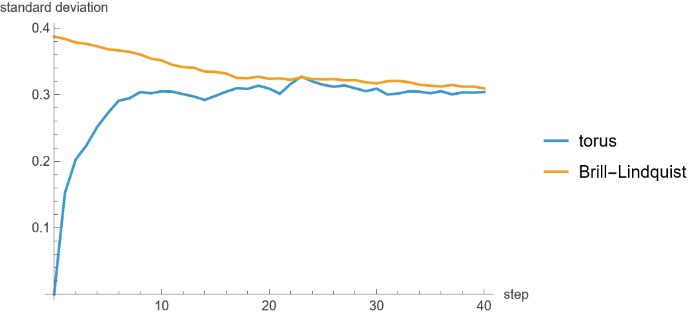

## Curvature of generated surfaces

A sphere is positively curved, and a torus and a Klein bottle are flat. A cylinder and a Mobius strip have a boundary. The table lists each generated surface's ball dimension and its scalar curvature from ball growth and from sphere growth:

```wl
Grid[Prepend[Table[With[{s = zeroStep[<|"Type" -> t, "Resolution" -> 12, "Height" -> 12, "Seed" -> 1|>]}, {t, s["Invariants", "BallDimension", "Mean"], s["Invariants", "BallScalarCurvature", "Mean"], s["Invariants", "SphereScalarCurvature", "Mean"]}], {t, {"Sphere", "Torus", "Klein", "Cylinder", "Mobius"}}], {"surface", "ball dimension", "ball curvature", "sphere curvature"}], Frame -> All]
```

## The dimension of a causal set

A sprinkling places random points in a box of Minkowski spacetime and joins causally related points. The dimensions read from graph distances differ from the spacetime dimension, because the undirected graph of causal links loses the time order that fixes the dimension of a causal set:

```wl
Grid[Prepend[Table[With[{s = zeroStep[<|"Type" -> "Sprinkling", "SpatialDim" -> k, "Density" -> 250, "Seed" -> 1|>]}, {k + 1, s["Invariants", "BallDimension", "Mean"], s["Invariants", "RiemannianBallDimension", "Mean"], s["Invariants", "SphereDimension", "Mean"]}], {k, {1, 2, 3}}], {"spacetime dimension", "ball (counting)", "ball (Riemannian)", "sphere"}], Frame -> All]
```

## Shortest paths and the continuum

Two points of a continuum have one shortest path, and two vertices of a lattice have exponentially many. The fraction of vertex pairs joined by one shortest path rises if evolution makes space more like a continuum:

```wl
ListLinePlot[{perStep[grTorus, "Invariants", "GeodeticFraction", "Mean"], perStep[grHoles, "Invariants", "GeodeticFraction", "Mean"]}, AxesLabel -> {"step", "geodetic fraction"}, PlotLegends -> {"torus", "Brill-Lindquist"}, ImageSize -> 400]
```

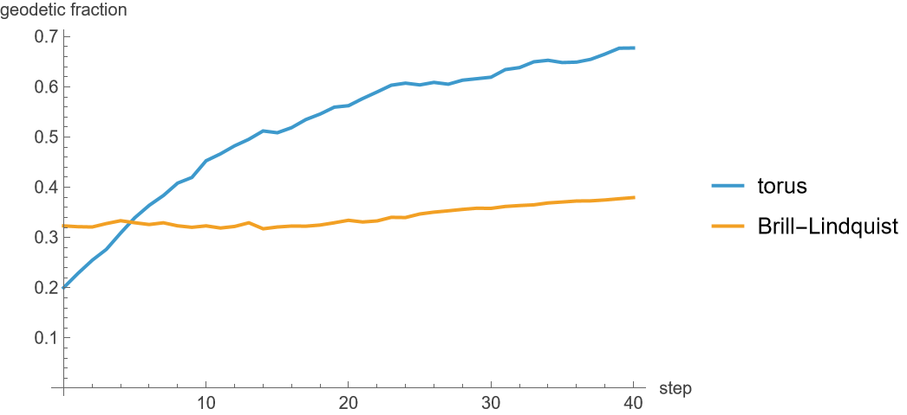

## Which rules grow a space of finite dimension?

The Infrageometry paclet uses three Wolfram models as substrates. Each runs for 300 steps of one random match per step, which follows a single history, with every two vertices of a hyperedge joined. A dimension that levels off marks a space of finite dimension:

```wl
survey = <|"wm6655" -> {{{1, 2}, {1, 3}} -> {{1, 2}, {1, 4}, {2, 4}, {3, 4}}, {{1, 1}, {1, 1}}}, "wm8619" -> {{{1, 2, 2}, {1, 3, 4}} -> {{4, 5, 5}, {5, 3, 2}, {1, 2, 5}}, {{1, 1, 1}, {1, 1, 1}}}, "wm1811" -> {{{1, 1, 2}, {1, 3, 4}} -> {{4, 4, 3}, {2, 5, 3}, {2, 5, 3}}, {{1, 1, 1}, {1, 1, 1}}}|>;
history1[{rule_, init_}] := HGEvolve[rule, init, 300, "StepStatistics", "UniformRandom" -> True, "MatchesPerStep" -> 1, "RandomSeed" -> 1, "StatisticsGraph" -> "AllPairs", "StepStatisticsMeasures" -> {"VolumeGrowth"}];
ListLinePlot[KeyValueMap[Callout[perStep[history1[#2], "Invariants", "BallDimension", "Mean"], #1] &, survey], AxesLabel -> {"step", "ball dimension"}, ImageSize -> 500]
```

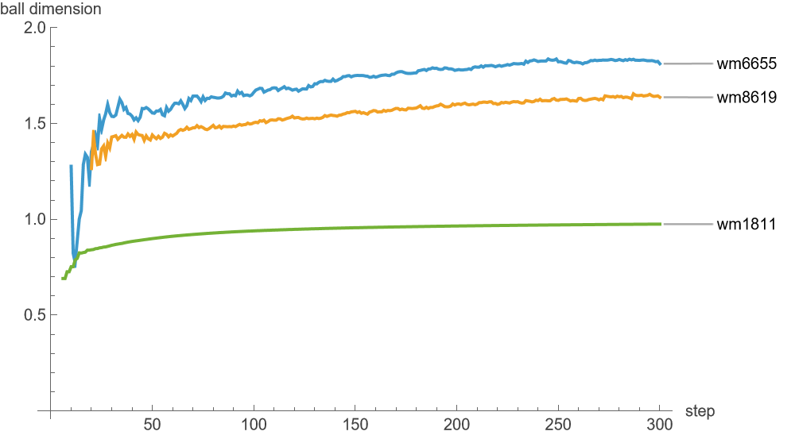

## Particle-like defects

A topological charge measures how far the neighbourhood of a vertex departs from a flat disc. A large charge that persists over many steps is a candidate for a particle-like structure:

```wl
ListLinePlot[{perStep[grTorus, "Invariants", "TopologicalChargeMax", "Mean"], perStep[grHoles, "Invariants", "TopologicalChargeMax", "Mean"]}, AxesLabel -> {"step", "largest charge"}, PlotLegends -> {"torus", "Brill-Lindquist"}, ImageSize -> 400]
```

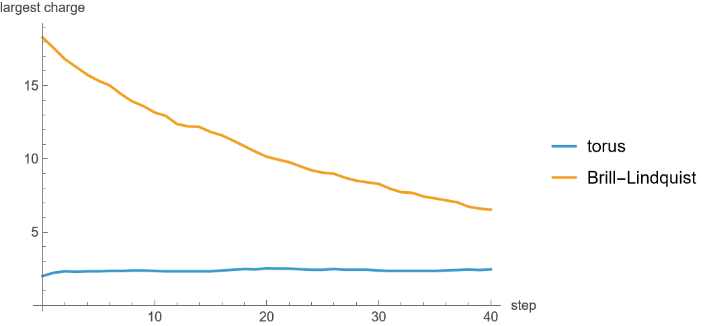

## The geometry of branchial space

The branchial graph of a step joins states with a common ancestor. The plots show the dimension of its largest component and that component's Ollivier-Ricci curvature with no idleness:

```wl
qm = HGEvolve[{{1, 2}, {1, 3}} -> {{1, 2}, {1, 4}, {2, 4}, {3, 4}}, {{1, 2}, {1, 3}}, 5, "StepStatistics", "StepStatisticsBranchial" -> "Graph", "StepStatisticsMeasures" -> All];
GraphicsRow[{ListLinePlot[Cases[perStep[qm, "BranchialDimension"], {_, _?NumericQ}], PlotMarkers -> Automatic, AxesLabel -> {"step", "branchial dimension"}], ListLinePlot[Cases[perStep[qm, "BranchialNonLazyOllivierRicciCurvature"], {_, _?NumericQ}], PlotMarkers -> Automatic, AxesLabel -> {"step", "branchial curvature"}, GridLines -> {None, {0}}]}, ImageSize -> 600]
```

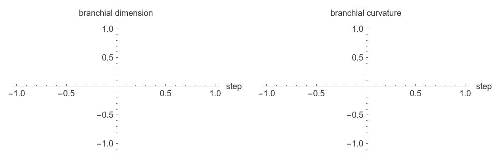

## Two graph conventions for hyperedges

With `"StatisticsGraph" -> "Consecutive"`, the default, a hyperedge {a, b, c} gives the graph edges a-b and b-c. With `"StatisticsGraph" -> "AllPairs"` it also gives a-c, as the Infrageometry paclet does:

```wl
ternary = {{1, 2, 3}} -> {{1, 2, 4}, {2, 4, 3}};
Table[{conv, Last[HGEvolve[ternary, {{1, 1, 1}}, 8, "StepStatistics", "StatisticsGraph" -> conv, "StepStatisticsMeasures" -> All]]["Invariants", "BallDimension", "Mean"]}, {conv, {"Consecutive", "AllPairs"}}]
```

## Cost-guided evolution

`"StateCost"` gives each state a cost computed from its `"Invariants"` statistics, and with `"MaxStatesPerStep" -> N` each step keeps its N successor states of lowest cost. The evolution is a beam search through the multiway system. Three beams of width 3 follow rule A from the torus for 16 steps. The first minimises the mean `"BallScalarCurvature"` of a state times its number of vertices, a discrete Einstein-Hilbert action. The changes of a statistic summed along a history equal its change from the first state to the last, so ranking the states of a step by curvature ranks their histories by the summed change of curvature. The second keeps the states whose `"BallDimension"` is closest to 2.5. The third has no cost and keeps the lowest-ranked states:

```wl
beam[cost_] := HGEvolve[ruleA, <|"Type" -> "Torus", "Resolution" -> 9, "Seed" -> 1|>, 16, {"States", "StepStatistics"}, "CanonicalizeStates" -> Full, "MaxStatesPerStep" -> 3, "StateCost" -> cost, "StepStatisticsMeasures" -> {"VolumeGrowth"}, "StepStatisticsWeighting" -> "Classes", "IncludeVertexCurvature" -> True, "RandomSeed" -> 1];
{action, target, plain} = beam /@ {#BallScalarCurvature #VertexCount &, Abs[#BallDimension - 2.5] &, None};
Length /@ Lookup[{action, target, plain}, "StepStatistics"]
```

<!-- => {17, 17, 17} -->

The mean over each step's kept states of the ball scalar curvature, which the first cost reads, and of the ball dimension, which the second cost reads:

```wl
Row[{ListLinePlot[Table[perStep[r["StepStatistics"], "Invariants", "BallScalarCurvature", "Mean"], {r, {action, target, plain}}], AxesLabel -> {"step", "curvature"}, PlotLegends -> {"total curvature", "dimension 2.5", "no cost"}, ImageSize -> 380], ListLinePlot[Table[perStep[r["StepStatistics"], "Invariants", "BallDimension", "Mean"], {r, {action, target, plain}}], AxesLabel -> {"step", "dimension"}, PlotLegends -> {"total curvature", "dimension 2.5", "no cost"}, ImageSize -> 380]}, Spacer[20]]
```

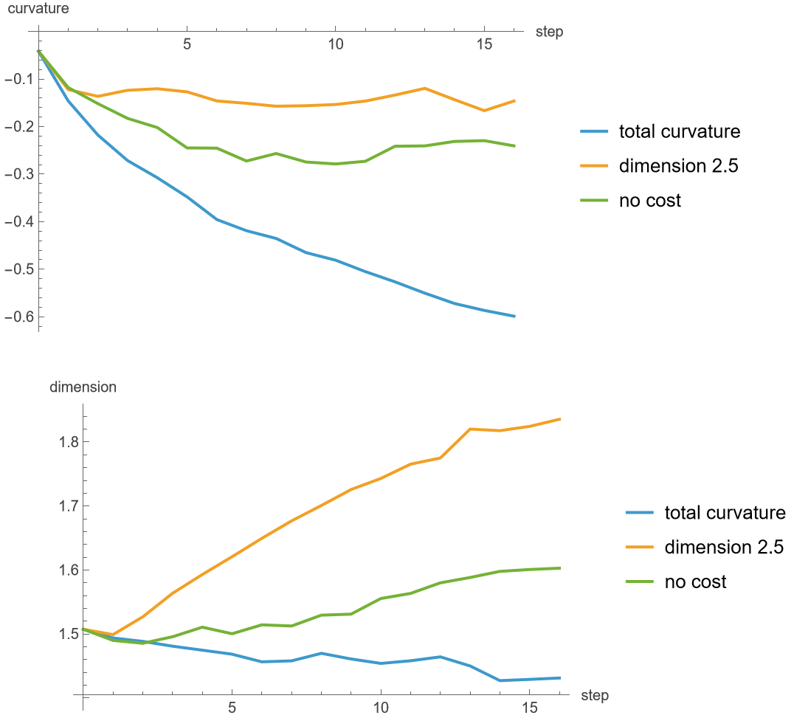

At step 16 the mean ball scalar curvature of the kept states is -0.60 under the first cost and -0.24 without a cost, and the mean ball dimension is 1.84 under the second cost and 1.60 without a cost.

A kept state of each guided beam at steps 0, 4, 8, 12 and 16, the beam of the total curvature above and the beam of dimension 2.5 below, each vertex coloured by its Ollivier-Ricci curvature from blue (the state's lowest) to red (its highest):

```wl
heat[state_] := With[{g = stateGraph[state], k = state["VertexCurvature"]}, Graph[g, VertexStyle -> Thread[VertexList[g] -> (ColorData["TemperatureMap"][Rescale[Lookup[k, #, 0], MinMax[Values[k]]]] & /@ VertexList[g])], VertexSize -> 1.2, EdgeStyle -> GrayLevel[0.6], PlotLabel -> "step " <> ToString[state["Step"]], ImageSize -> 170]];
Grid[Table[heat[SelectFirst[Values[r["States"]], Function[st, st["Step"] == s]]], {r, {action, target}}, {s, {0, 4, 8, 12, 16}}]]
```

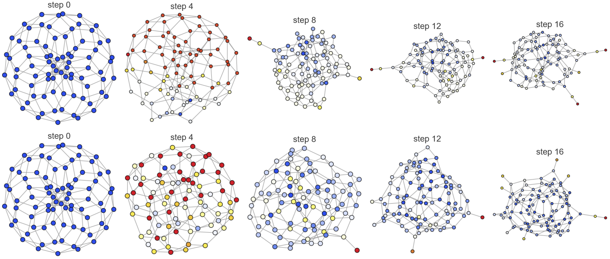
